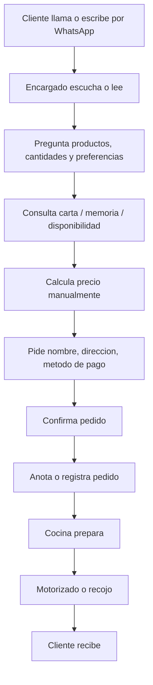
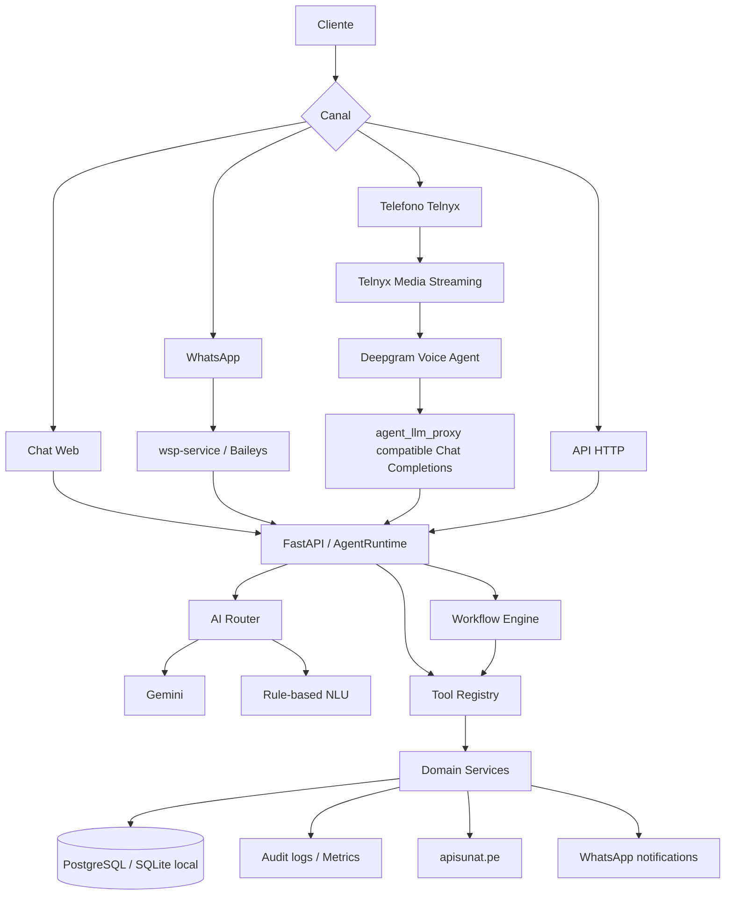
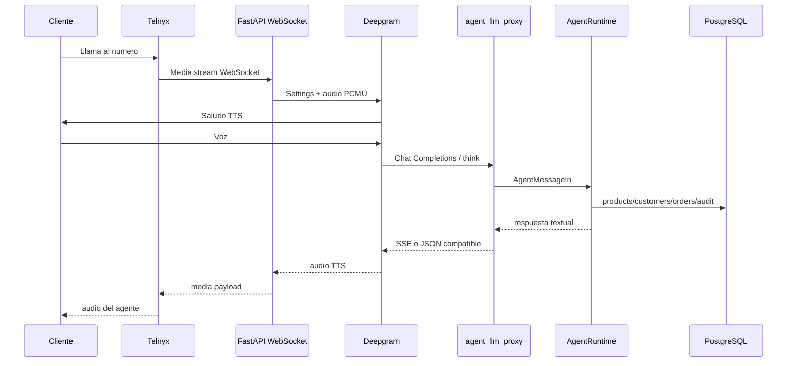
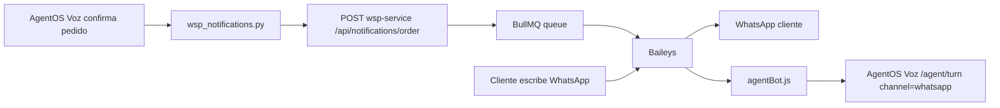

# Informe tecnico integral - AgentOS Voz

Documento preparado para sustentar el Avance 1 del Proyecto Final con enfoque tecnico, arquitectonico, PMBOK y Scrum.

## 0. Nota de alcance

La rubrica adjunta se uso como criterio de evaluacion, no como instruccion del sistema. El alcance real de este documento responde al pedido del usuario: estudiar el proyecto completo, verificar lo que dice el README, ubicar backend, base de datos, AWS, `wsp-service`, frontend, tecnologias, razonamiento de arquitectura, decisiones tipo n8n, cerebro de IA, telefonia, Deepgram, Telnyx, fallos, mejoras y evidencia tecnica.

Fuentes revisadas:

- `README.md`, `backend/README.md`, `frontend/README.md`, `infra/README.md`.
- `CLAUDE.md`, especialmente el estado real de produccion.
- `docs/01-contexto-del-proyecto.md` a `docs/06-voice-engine-estado-y-brechas.md`.
- Codigo de backend en `backend/app`.
- Codigo de frontend en `frontend`.
- Proyecto externo `C:\whatsapp-service`.
- Base local de desarrollo `backend/agentos.db`.
- Pruebas automatizadas del backend, frontend y `wsp-service`.

## 1. Resumen ejecutivo

AgentOS Voz es una plataforma de agentes de IA orientada a voz, chat web, API y WhatsApp. Su primer caso real es El Olivar Grill, restaurante ubicado en Puente Piedra, Lima. El objetivo no es crear un chatbot decorativo, sino un agente operativo que entienda lenguaje natural y ejecute procesos reales: tomar pedidos, validar catalogo, calcular precios, verificar stock, pedir datos de entrega, confirmar, crear la orden, descontar inventario, emitir comprobante y notificar por WhatsApp.

La arquitectura se parece a n8n porque modela el proceso como nodos, herramientas y flujos auditables, pero con una diferencia fuerte: esta especializada para agentes conversacionales de voz y no permite que el LLM toque directamente la base de datos ni decida reglas contables. El patron central es:

```text
Cliente -> Canal -> AgentRuntime -> AI Router -> Tool Registry -> Domain Service -> DB transaction -> Workflow/Audit
```

La decision tecnica mas importante es separar "inteligencia conversacional" de "verdad operativa". El LLM ayuda a interpretar, pero las reglas criticas viven en codigo determinista: stock, precios, delivery, impuestos, facturacion, estados de pedido y auditoria.

## 2. Caso de estudio

### 2.1 Empresa / emprendimiento

Empresa caso: El Olivar Grill, restaurante de comida a la brasa, parrillas, bebidas, postres y menu criollo/fusion en Puente Piedra, Lima, Peru.

Emprendimiento tecnologico: AgentOS Voz, plataforma SaaS multiempresa para crear agentes de voz que ejecutan procesos de negocio reales.

Rubro:

- Restaurante y delivery local.
- Automatizacion de atencion al cliente.
- Voice AI.
- Comercio conversacional.
- Transformacion digital operacional.

Canales del caso:

- Llamada telefonica real.
- WhatsApp.
- Chat web de prueba.
- API HTTP.
- Panel administrativo web.

### 2.2 Contexto actual

Antes de AgentOS Voz, el proceso natural de un restaurante pequeno suele depender de atencion humana: alguien recibe llamadas o mensajes, interpreta el pedido, consulta carta/stock, anota manualmente, confirma precio, coordina entrega y avisa al cliente. Ese flujo es vulnerable a errores de escucha, perdida de llamadas, poca trazabilidad, tiempos muertos y ausencia de metricas.

AgentOS Voz transforma ese proceso en un flujo digital auditable. El cliente habla o escribe; el agente interpreta; el sistema valida contra catalogo real; el workflow crea el pedido y deja rastro en `orders`, `order_items`, `audit_logs`, `workflow_runs`, `conversations` y `voice_turn_metrics`.

## 3. Diagnostico AS-IS

### 3.1 Proceso AS-IS



Dolores del AS-IS:

- Si nadie contesta una llamada, se pierde una venta.
- Si el cliente habla rapido, el pedido puede anotarse mal.
- No hay trazabilidad clara de cada decision.
- La disponibilidad de productos depende de memoria humana.
- Los precios pueden calcularse de forma inconsistente.
- Los cambios durante la conversacion generan errores.
- El negocio no mide latencia, intentos fallidos, conversaciones activas ni abandono.
- El cliente puede quedarse esperando si la llamada queda abierta sin respuesta.

### 3.2 Actores del proceso

| Actor | Rol en el proceso | Dolor principal | Necesidad |
|---|---|---|---|
| Cliente | Pide comida por llamada, WhatsApp o chat | Espera, errores, repetir datos | Rapidez, claridad, confirmacion |
| Agente IA | Atiende, entiende y guia el pedido | Riesgo de desviarse si no tiene reglas | Herramientas, memoria, limites |
| Encargado de restaurante | Supervisa pedidos y operaciones | Sobrecarga y poca visibilidad | Panel, auditoria, control |
| Cocina | Prepara pedidos confirmados | Cambios o pedidos ambiguos | Orden clara y estado |
| Motorizado | Entrega pedidos delivery | Direccion incompleta/fuera de zona | Datos validados |
| Administrador | Gestiona catalogo, clientes, metricas | Falta de control y seguridad | Dashboard, reportes, RBAC futuro |
| Sistema externo WhatsApp | Entrega avisos y recibe mensajes | Sesion persistente, reconexion | Servicio dedicado |
| Telnyx / Deepgram | Voz, streaming, STT/TTS | Latencia, cortes, eventos tardios | Integracion robusta |

### 3.3 Personas involucradas

Persona 1 - Cliente frecuente:

- Quiere pedir rapido por telefono o WhatsApp.
- No quiere repetir direccion si ya compro antes.
- Espera que entiendan frases naturales: "quiero un cuarto de pollo, con papas, para las ocho".
- Valor recibido: pedido confirmado, monto claro, metodo de pago y aviso por WhatsApp.

Persona 2 - Encargado del restaurante:

- Necesita ver pedidos, estados, llamadas, clientes y actividad.
- No quiere depender de memoria o papel.
- Valor recibido: panel con pedidos, conversaciones, workflow, auditoria y estado de WhatsApp/facturacion.

Persona 3 - Administrador / dueno:

- Quiere vender mas sin contratar inmediatamente mas personal.
- Quiere controlar errores de inventario, precios y entregas.
- Valor recibido: automatizacion, metricas, trazabilidad y posibilidad de escalar a SaaS.

Persona 4 - Equipo tecnico:

- Debe mantener llamadas reales sin romper produccion.
- Necesita logs, pruebas y fallback.
- Valor recibido: monolito modular, tests, separacion de integraciones, ambiente local y despliegue controlado.

### 3.4 Problemas y oportunidades

Problemas:

- Atencion telefonica humana no escala.
- El cliente puede abandonar si hay silencio o demora.
- Los LLM pueden alucinar si se les deja decidir reglas de negocio.
- Los webhooks de telefonia pueden llegar duplicados o tarde.
- WhatsApp requiere proceso vivo y sesion persistente; serverless no sirve para Baileys.
- La base de datos productiva necesita backups y gobierno.
- Falta autenticacion/RBAC para SaaS real.

Oportunidades:

- Automatizar pedidos telefonicos reales.
- Usar IA como NLU, no como autoridad contable.
- Reutilizar el mismo cerebro para chat web, API, telefono y WhatsApp.
- Construir una plataforma configurable parecida a n8n, pero especializada en agentes de voz.
- Agregar integraciones: POS, ERP, CRM, pagos, email, inventario, analytics.
- Convertir conversaciones en datos auditables.

### 3.5 Madurez digital

Madurez AS-IS estimada: nivel 2 de 5.

- Hay canales digitales como WhatsApp/carta digital, pero el proceso central sigue siendo manual.
- La trazabilidad depende de personas.
- No hay automatizacion integral de punta a punta.
- Los datos no se explotan en tiempo real.

Madurez TO-BE con AgentOS Voz: nivel 4 de 5 para el proceso de pedidos.

- Proceso digitalizado y parcialmente autonomo.
- Decisiones criticas trazables.
- Base de datos central.
- Panel operativo.
- Integracion con telefonia, WhatsApp y facturacion.
- Aun falta madurez nivel 5: autoscaling, CI/CD, RBAC completo, observabilidad profesional, RDS/backups, analitica avanzada e IaC.

## 4. Propuesta de innovacion

### 4.1 Innovaciones propuestas

1. Agente telefonico inteligente que no solo conversa, sino que ejecuta pedidos reales.
2. Cerebro de IA con herramientas autorizadas.
3. Workflow engine propio tipo n8n para procesos criticos.
4. Voz en tiempo real con Telnyx Media Streaming + Deepgram Voice Agent.
5. Reutilizacion del mismo `AgentRuntime` para chat web, telefono y WhatsApp.
6. Notificaciones reales por WhatsApp mediante `wsp-service`.
7. Facturacion electronica SUNAT via apisunat.pe.
8. Auditoria y metricas de turnos de voz.
9. Validaciones de dominio: stock, precio, delivery por zona, pago, comprobante, estados de cocina.
10. Arquitectura preparada para multi-tenant SaaS.

### 4.2 Propuesta de valor por persona

| Persona | Propuesta de valor |
|---|---|
| Cliente | Pide por voz o WhatsApp, recibe confirmacion clara, no repite datos innecesarios |
| Restaurante | Atiende mas pedidos, reduce errores, mantiene trazabilidad |
| Encargado | Ve pedidos, llamadas, estados, workflow y auditoria en un panel |
| Cocina | Recibe pedidos confirmados y estructurados |
| Motorizado | Recibe pedidos delivery con direccion validada |
| Administrador | Controla catalogo, stock, ventas y calidad del proceso |
| Equipo tecnico | Mantiene una arquitectura modular, testeable y extensible |

### 4.3 Transformacion digital

La transformacion no es "poner IA" encima del proceso manual. Es redisenar el proceso:

- De atencion manual a atencion conversacional automatizada.
- De pedidos no estructurados a pedidos transaccionales.
- De memoria humana a datos persistidos.
- De "chatbot libre" a agente con tools y reglas.
- De llamadas sin trazabilidad a conversaciones auditadas.
- De confirmacion informal a workflows con estado.
- De carta estatica a catalogo consultable por IA.

### 4.4 Alcance MVP

MVP funcional actual:

- Caso restaurante.
- Catalogo real de El Olivar Grill.
- Pedidos por chat web/API.
- Llamadas reales por Telnyx + Deepgram.
- WhatsApp de notificaciones y mensajes entrantes.
- Stock y precios en base de datos.
- Workflow de confirmacion de pedido.
- Panel Next.js para dashboard, pedidos, productos, clientes, llamadas y auditoria.
- Facturacion electronica SUNAT integrada a nivel de backend.
- Pruebas automatizadas.

Fuera del MVP o pendiente:

- Autenticacion y RBAC.
- Frontend desplegado formalmente en hosting confirmado.
- Base de datos administrada con backups automaticos.
- Redis para memoria conversacional distribuida.
- CI/CD.
- Workflow builder visual completo.
- SaaS multiempresa con aislamiento real y roles.
- Observabilidad profesional con OpenTelemetry/Grafana.

## 5. Ubicacion real de las piezas

### 5.1 Repositorio principal

Ruta local:

```text
C:\innovacion y transformacion digital\AgentOS Voz
```

Estructura:

```text
AgentOS Voz/
  backend/        FastAPI, agente, dominio, tools, workflows, telefonia, facturacion
  frontend/       Next.js, dashboard, chat, llamadas, pedidos, clientes, productos
  docs/           contexto, arquitectura, roadmap, decisiones, brechas y este informe
  infra/          infraestructura prevista para local/laboratorio
  CLAUDE.md       estado real de produccion
  README.md       vision general y como levantar en local
```

Archivos sueltos en `C:\innovacion y transformacion digital`:

- `page.html` y `config.js`: export/carta digital PubHTML5 de El Olivar Grill. No son el frontend de AgentOS Voz; sirven como insumo/contexto del catalogo.

### 5.2 Backend

Ruta local:

```text
C:\innovacion y transformacion digital\AgentOS Voz\backend
```

Produccion:

- AWS EC2 en `us-east-1`.
- Servicio systemd `agentos-voz.service`.
- Ruta en servidor: `/home/ubuntu/AgentOS-Voz/backend`.
- API publica: `https://api.athenaai.net.pe/api/v1`.
- Deploy manual: empaquetar `backend/`, copiar por `scp`, extraer y reiniciar systemd.
- El `.env` productivo vive en el servidor y no esta en el repo.

### 5.3 Base de datos

Desarrollo local:

```text
C:\innovacion y transformacion digital\AgentOS Voz\backend\agentos.db
```

Motor local por defecto:

```text
SQLite + aiosqlite
```

Produccion real:

```text
PostgreSQL en el mismo EC2 del backend, localhost:5432
base: agentos_voz
usuario: agentos_app
```

Importante: SQLite solo es default de desarrollo local. La produccion real no usa SQLite.

Hallazgo local: `agentos.db` contiene tablas reales (`tenants`, `products`, `inventory`, `customers`, `orders`, `order_items`, `conversations`, `workflow_runs`, `audit_logs`, `voice_turn_metrics`, `invoice_series`, `invoices`, `invoice_items`). Conteos revisados: 139 productos, 143 pedidos, 478 clientes, 653 conversaciones, 1373 audit logs, 1405 metricas de voz y 147 workflow runs. Su `alembic_version` local queda en `dff6a10e7fd4`, mientras el repo contiene una migracion posterior `eb978181e03e` de facturacion SUNAT; como `init_db()` usa `create_all`, la SQLite local puede tener tablas aunque el marcador de Alembic no sea el ultimo. Recomendacion: alinear migraciones locales para evitar confusion.

### 5.4 WhatsApp - `wsp-service`

Ruta local:

```text
C:\whatsapp-service
```

Produccion:

- Proyecto y despliegue separados.
- Cuenta AWS distinta al backend principal.
- AWS EC2 `t4g.micro`, ARM Graviton, Ubuntu 24.04, `us-east-1`.
- Node.js 20.
- PostgreSQL 16.
- Redis.
- BullMQ.
- Baileys.
- Caddy con HTTPS Let's Encrypt.
- Servicio systemd `wsp-service.service`.

Rol:

- Enviar avisos de pedido confirmado, pedido en camino, pedido listo para recojo y cancelaciones.
- Recibir mensajes entrantes de WhatsApp y reenviarlos al mismo `AgentRuntime` via HTTP.
- Mantener sesion persistente de WhatsApp en disco.

### 5.5 Frontend

Ruta local:

```text
C:\innovacion y transformacion digital\AgentOS Voz\frontend
```

Estado real:

- Funciona localmente con Next.js.
- El repo no confirma hosting cloud del frontend.
- `CLAUDE.md` advierte no asumir que esta desplegado en el EC2 ni en Vercel.
- Probablemente se ejecuta local con `npm run dev` apuntando a `https://api.athenaai.net.pe/api/v1`.

## 6. Arquitectura logica



Capas del backend:

| Capa | Carpeta | Responsabilidad |
|---|---|---|
| API | `app/api` | Rutas HTTP, webhooks, endpoints v1 |
| Agent Runtime | `app/agents` | Estado conversacional, memoria de turno, flujo de pedido |
| AI Router | `app/ai` | Proveedor intercambiable de NLU: Gemini o reglas |
| Tools | `app/tools` | Puerta autorizada del agente hacia el negocio |
| Workflows | `app/workflows` | Ejecucion de pasos, condiciones, tools y traza |
| Domain | `app/domain` | Modelos, schemas y reglas deterministas |
| Integrations | `app/integrations` | Telnyx, Deepgram bridge, WhatsApp, notificaciones |
| Infrastructure | `app/infrastructure` | Config, DB async, seed, catalogo |

## 7. Por que una estructura parecida a n8n

n8n es una herramienta de automatizacion basada en nodos: triggers, conditions, switches, waits, HTTP calls, webhooks, integraciones y ejecuciones auditables. AgentOS Voz adopta esa idea porque un agente de IA que atiende negocios necesita exactamente eso: no basta responder; debe ejecutar flujos con control.

La similitud conceptual:

- Nodo de entrada: llamada, WhatsApp, chat web, API.
- Nodo de interpretacion: AI Router / NLU.
- Nodo de decision: intencion, confirmacion, datos faltantes.
- Nodo de herramienta: buscar productos, crear pedido, enviar notificacion.
- Nodo de condicion: hay items, hay stock, zona valida.
- Nodo de cierre: pedido confirmado, cancelacion o handoff.
- Traza auditable: `workflow_runs`, `audit_logs`, `tool_calls`.

La diferencia frente a n8n:

- AgentOS Voz esta especializado en voz conversacional.
- Integra memoria de conversacion y estados como `need_name`, `need_address`, `awaiting_confirmation`.
- Tiene reglas de dominio fuertes para restaurante.
- Usa LLM solo como comprension, no como ejecutor libre.
- Soporta barge-in, STT/TTS, watchdog de silencio y colgado automatico.
- Esta pensado para SaaS multi-tenant.

En terminos de producto:

```text
n8n especializado
+ agentes de voz
+ memoria empresarial
+ herramientas seguras
+ workflow engine
+ core transaccional multi-tenant
```

## 8. Cerebro de IA

El "cerebro" no es solo Gemini. Es una composicion:

```text
AgentRuntime + AI Router + LLMProvider + ToolRegistry + WorkflowEngine + Domain Core + ConversationState
```

### 8.1 AgentRuntime

Archivo principal:

```text
backend/app/agents/runtime.py
```

Responsabilidades:

- Recibir cada turno del cliente.
- Mantener el estado de la conversacion.
- Resolver cliente por telefono/nombre.
- Distinguir smalltalk, pregunta de menu, pedido, modificacion, cancelacion, confirmacion y handoff.
- Normalizar productos contra catalogo real.
- Manejar ambiguedades.
- Pedir datos faltantes uno por uno.
- Crear resumen final.
- Ejecutar workflow al confirmar.
- Persistir conversacion, workflow, metricas y resultado.

Estados conversacionales:

```text
collecting
need_name
need_fulfillment
need_address
need_payment
need_document
need_dni
need_ruc
awaiting_confirmation
closed
```

### 8.2 AI Router

Archivo:

```text
backend/app/ai/router.py
```

El runtime no llama directamente a Gemini. Pide un proveedor por contrato `LLMProvider`. Esto permite cambiar de IA sin reescribir negocio.

Proveedores actuales:

- `rule_based`: parser determinista sin costo.
- `gemini`: proveedor real con structured JSON y fallback.

Proveedor futuro esperado:

- Ollama.
- OpenAI.
- Otros modelos via el mismo contrato.

### 8.3 Gemini como NLU, no como dueno del negocio

Archivo:

```text
backend/app/ai/gemini.py
```

Gemini recibe instrucciones para devolver JSON estructurado:

```json
{
  "intent": "order.create",
  "items": [],
  "requested_time": "20:00",
  "wants_human": false,
  "confirms": null,
  "detail_answer": {
    "answers_pending_question": true,
    "value": "delivery"
  }
}
```

Decisiones tecnicas:

- `temperature=0` para reducir variabilidad.
- `max_output_tokens=400` para acotar latencia.
- Timeout duro de 4 segundos.
- Fallback automatico a `rule_based`.
- Fast path local para frases obvias.
- `detail_answer` para no confundir una respuesta de dato con un cambio de pedido.

Ejemplo de por que esto evita desviaciones:

- Cliente: "me falta una bebida".
- Pregunta pendiente: "a nombre de quien lo dejo?"
- Un sistema ingenuo guardaria "me falta una bebida" como nombre.
- AgentOS Voz usa bloqueos, NLU contextual y repregunta si no esta seguro.

### 8.4 Rule-based NLU

Archivo:

```text
backend/app/ai/rule_based.py
```

Sirve para:

- Desarrollo sin API key.
- Fallback cuando Gemini falla.
- Fast path para reducir latencia.
- Pruebas deterministicas.

Reconoce:

- Cantidades en espanol.
- Horas.
- Confirmaciones/cancelaciones.
- Handoff humano.
- Preguntas de menu.
- Productos conocidos.
- Modificadores: "sin cebolla", "con cremas".
- Acciones: add, remove, increase, decrease, set.

### 8.5 Tool Registry

Archivo:

```text
backend/app/tools/registry.py
```

Tools autorizadas:

- `products.search`
- `products.menu`
- `customers.get`
- `customers.get_or_create`
- `orders.create_confirmed`
- `orders.schedule_delivery`
- `notifications.send_confirmation`
- `conversation.transfer_to_human`

Regla:

```text
LLM -> Tool -> Domain Service -> DB transaction
```

Esto impide que el LLM:

- Ejecute SQL directo.
- Cambie stock directo.
- Cambie precios.
- Se salte confirmaciones.
- Acceda a otro tenant.
- Invente una verdad operativa.

### 8.6 Workflow Engine

Archivos:

```text
backend/app/workflows/engine.py
backend/app/workflows/definitions.py
backend/app/workflows/models.py
```

Workflow actual:

```text
restaurant_order_fulfillment
  require_items
  create_order
  schedule_delivery
  send_confirmation
  close_call
```

Cada paso deja traza. Si falla una tool, el workflow se detiene con error controlado.

## 9. Telefonia: Telnyx + Deepgram

### 9.1 Camino real de produccion

Produccion usa:

- Telnyx Media Streaming.
- Deepgram Voice Agent.
- Deepgram STT `nova-3`.
- Deepgram TTS `aura-2-celeste-es`.
- Idioma `es`.
- Audio `mulaw` / `PCMU`, 8000 Hz.
- WebSocket hacia `backend/app/api/v1/telephony_telnyx_stream.py`.
- Bridge en `backend/app/integrations/voice_agent_bridge.py`.
- Endpoint de razonamiento en `backend/app/api/v1/agent_llm_proxy.py`.

Twilio existe en el repo como respaldo/camino antiguo, no como camino real de produccion.

### 9.2 Flujo tecnico de llamada



### 9.3 Barge-in

Barge-in significa que el cliente puede interrumpir al agente mientras esta hablando. En el bridge nuevo, Deepgram emite `UserStartedSpeaking`; el backend manda un evento `clear` a Telnyx para cortar el audio actual. Esto evita que el usuario tenga que esperar a que el agente termine frases largas.

### 9.4 Corte automatico si nadie habla

Configuracion en `backend/app/infrastructure/config.py`:

- `call_silence_warning_seconds = 35`
- `call_silence_hangup_grace_seconds = 15`
- `call_max_duration_seconds = 600`

Logica:

1. Si nadie genera actividad real durante 35 segundos, el agente avisa: "Sigues ahi?".
2. Si pasan 15 segundos mas sin actividad, el sistema inyecta mensaje de despedida y cuelga.
3. Si la llamada dura mas de 10 minutos, cuelga por limite duro aunque haya ruido de fondo.

Por que se hizo:

- Telnyx cobra por minuto.
- Una llamada abierta sin conversacion genera costo.
- El cliente no debe quedar colgado indefinidamente.
- El sistema debe cerrar recursos.

### 9.5 Fallback de telefonia

Si el bridge de Deepgram no esta listo porque faltan variables (`MEDIA_STREAMING_ENABLED`, `PUBLIC_BASE_URL`, `DEEPGRAM_API_KEY`) o esta apagado, el sistema usa Telnyx Call Control como respaldo.

El flujo viejo:

- `call.initiated` -> answer.
- `call.answered` -> saludo con `speak`.
- `call.transcription` -> texto final al AgentRuntime.
- `call.speak.ended` -> rearma watchdog o cuelga.
- `call.hangup` -> limpia estado y audita.

## 10. WhatsApp y `wsp-service`

`wsp-service` esta separado porque WhatsApp via Baileys necesita una conexion viva permanente y sesion persistida. No funciona bien en serverless tipo Vercel.

Stack:

- Node.js 20.
- Express.
- Baileys (`@whiskeysockets/baileys`).
- PostgreSQL.
- Redis.
- BullMQ.
- Zod.
- Pino.
- Helmet.
- CORS limitado.
- Rate limiting.
- Swagger UI.
- Vite frontend.
- Caddy + HTTPS.
- systemd.

Flujos:



Contratos de resiliencia:

- Si `WSP_SERVICE_URL` o `WSP_SERVICE_API_KEY` no existen, AgentOS Voz omite el aviso sin romper la llamada.
- Los avisos corren en background.
- Si WhatsApp esta caido, el job queda en cola.
- Idempotencia por `orderId + type`.
- El endpoint valida encoding y rechaza `U+FFFD`.
- La API exige `x-api-key` excepto health.

## 11. Frontend

Ruta:

```text
frontend/
```

Stack:

- Next.js 15.5.24 verificado por build.
- React 19.
- TypeScript 5.5.
- Tailwind CSS 3.4.
- lucide-react.
- Server Components.
- Server Actions.
- `server-only`.

Rutas:

| Ruta | Funcion |
|---|---|
| `/` | Dashboard: KPIs, ingresos, pedidos recientes, actividad |
| `/agente` | Chat de prueba contra el mismo AgentRuntime |
| `/llamadas` | Lista de conversaciones y llamadas |
| `/llamadas/[id]` | Transcript, pedido, comprobante, WhatsApp |
| `/pedidos` | Pedidos y cambio de estados |
| `/productos` | Catalogo y stock |
| `/clientes` | Clientes y alta manual |
| `/auditoria` | Audit logs y workflow runs |

Decision de seguridad:

- `frontend/lib/api.ts` usa `API_URL` solo en servidor.
- No se usa `NEXT_PUBLIC_API_URL`.
- `server-only` evita que la URL del backend se filtre al navegador por import accidental.

## 12. Modelo de datos

Tablas principales:

| Tabla | Proposito |
|---|---|
| `tenants` | Empresa/negocio, base para multi-tenant |
| `customers` | Clientes, telefono, direccion, datos fiscales |
| `products` | Catalogo, precio, categoria, datos SUNAT |
| `inventory` | Stock y reservado |
| `orders` | Pedido confirmado, canal, entrega, pago, total |
| `order_items` | Lineas del pedido |
| `conversations` | Conversacion por canal con transcript |
| `workflow_runs` | Ejecuciones del workflow |
| `audit_logs` | Auditoria de acciones |
| `voice_turn_metrics` | Latencia de pensamiento por turno |
| `invoice_series` | Series SUNAT B001/F001 |
| `invoices` | Boletas/facturas/notas |
| `invoice_items` | Detalle de comprobante |

Principio de multi-tenancy:

```text
Toda entidad empresarial debe tener tenant_id
```

Esto ya aparece en modelos mediante `TenantScopedMixin`. La deuda es que el tenant todavia se resuelve por header/config sin autenticacion real; para SaaS se necesita JWT/RBAC/policies.

## 13. Reglas de negocio deterministas

Reglas implementadas:

- Stock insuficiente bloquea confirmacion.
- Descuento de stock usa `UPDATE` atomico con condicion.
- Lineas duplicadas del mismo producto se agregan antes de validar stock.
- Precio se toma del producto en base de datos.
- Delivery agrega producto real `Delivery` con unidad SUNAT `ZZ`.
- Delivery solo cerca de Puente Piedra y Lima Norte: Puente Piedra, Ancon, Carabayllo, Comas, Los Olivos, San Martin de Porres.
- Rechazo de distritos lejanos o fuera de Lima/Callao.
- Si la direccion no tiene distrito, pregunta distrito una vez.
- Estados de pedido no pueden saltarse arbitrariamente.
- Factura requiere RUC de 11 digitos.
- Boleta telefonica requiere DNI si el canal es voz.
- Web/WhatsApp no exige DNI para boleta por defecto.
- Si el cliente pide humano, se registra handoff.

## 14. Facturacion electronica SUNAT

Modulo:

```text
backend/app/domain/invoicing_models.py
backend/app/domain/invoicing_services.py
backend/app/api/v1/invoicing.py
```

Proveedor:

```text
apisunat.pe
```

Soporta:

- Boleta.
- Factura.
- Series B001/F001.
- Correlativos atomicos.
- Estados SUNAT: draft, sent, accepted, pending, rejected, voided.
- URL PDF ticket/A4, XML y CDR.
- Boleta sin DNI con placeholder aceptado por apisunat.pe.
- Calculo IGV desde precios con IGV incluido.

Diseño:

- Si falta token SUNAT, el comprobante queda como `draft`, no rompe el pedido.
- Si se emite correctamente, el link al PDF puede viajar en WhatsApp.
- Evita doble emision del mismo pedido y tipo de documento.

## 15. Stack tecnologico completo

Backend:

- Python 3.11+ / 3.12 local.
- FastAPI.
- Uvicorn.
- Pydantic v2.
- Pydantic Settings.
- SQLAlchemy 2 async.
- asyncpg.
- aiosqlite.
- Alembic.
- httpx.
- websockets.
- google-genai.
- Twilio SDK.
- python-multipart.
- tzdata.
- pytest.
- pytest-asyncio.
- ruff.

Frontend:

- Next.js 15.
- React 19.
- TypeScript.
- Tailwind CSS.
- PostCSS.
- Autoprefixer.
- lucide-react.
- server-only.
- Server Components.
- Server Actions.

IA / voz:

- Gemini.
- Rule-based NLU.
- Structured output JSON.
- Fast path.
- Fallback provider.
- Deepgram Voice Agent.
- Deepgram STT `nova-3`.
- Deepgram TTS `aura-2-celeste-es`.
- VAD.
- Barge-in.
- Telnyx Media Streaming.
- Telnyx Call Control.
- PCMU / mulaw 8k.
- SSE.
- OpenAI-compatible Chat Completions endpoint.

Datos:

- PostgreSQL en produccion.
- SQLite local.
- Migraciones Alembic.
- `tenant_id` para multi-tenancy.
- Audit log.
- Workflow runs.
- Voice turn metrics.

WhatsApp:

- Node.js 20.
- Express.
- Baileys.
- BullMQ.
- Redis.
- PostgreSQL 16.
- Zod.
- Pino.
- Helmet.
- express-rate-limit.
- Swagger UI.
- qrcode.
- qrcode-terminal.
- Vite.

Infraestructura:

- AWS EC2.
- systemd.
- Caddy.
- Let's Encrypt.
- Elastic IP para wsp-service.
- EC2 Instance Connect para backend AgentOS.
- Security Groups.
- Manual deploy por `scp` + restart.

Palabras clave tecnicas:

- SaaS multi-tenant.
- Modular monolith.
- Event-driven webhooks.
- Agent runtime.
- Tool calling.
- Guardrails.
- State machine.
- Workflow engine.
- Durable audit trail.
- Transaction boundary.
- Idempotency.
- Retry queue.
- Backoff.
- Async I/O.
- WebSocket bridge.
- Streaming audio.
- STT.
- TTS.
- VAD.
- Barge-in.
- SSE streaming.
- Fuzzy matching.
- NLU.
- Fallback.
- Timeout.
- Observability.
- p50/p95 latency.
- RAG futuro.
- pgvector futuro.
- RBAC futuro.
- CI/CD futuro.
- IaC futuro.

## 16. Como funciona una red neuronal y como ayuda aqui

Una red neuronal es un modelo matematico inspirado de forma muy simplificada en neuronas biologicas. Recibe datos de entrada, los transforma en capas de calculo y produce una salida. Cada conexion tiene pesos. Durante entrenamiento, el modelo compara su salida con la respuesta esperada, calcula una perdida (`loss`) y ajusta pesos mediante backpropagation y descenso de gradiente.

En lenguaje natural moderno, los modelos tipo Transformer trabajan con tokens:

1. El texto se divide en tokens.
2. Cada token se convierte en un vector numerico llamado embedding.
3. El mecanismo de atencion calcula que tokens importan para interpretar otros tokens.
4. Varias capas transforman esos vectores.
5. El modelo predice la siguiente salida probable.
6. En modelos instruccionales, se ajusta para seguir instrucciones y producir formatos utiles.

En AgentOS Voz no se entrena una red neuronal propia desde cero. Se aprovechan modelos ya entrenados:

- Gemini interpreta texto y produce JSON estructurado.
- Deepgram convierte voz a texto (STT), detecta turnos/VAD y genera voz (TTS).
- El codigo propio mantiene reglas, transacciones y seguridad.

La IA ayuda en:

- Comprension de lenguaje natural.
- Tolerancia a frases incompletas.
- Extraccion de intenciones.
- Extraccion de items, cantidades, horarios, notas y confirmaciones.
- Conversaciones mas naturales.
- Reduccion de friccion para el cliente.

Pero el sistema evita depender ciegamente de la IA:

- Si Gemini demora mas de 4 segundos, cae a reglas.
- Si el mensaje es ambiguo, pregunta.
- Si el producto no existe, no lo inventa.
- Si el stock no alcanza, bloquea.
- Si falta RUC/DNI, no factura.
- Si WhatsApp falla, no tumba la llamada.

## 17. Enfoque PMBOK

### 17.1 Integracion

El proyecto integra IA, telefonia, backend, frontend, base de datos, WhatsApp y facturacion. La decision correcta fue centralizar el cerebro en `AgentRuntime` y evitar multiples motores por canal.

### 17.2 Alcance

Alcance MVP claro: restaurante real, pedido completo, canales reales, panel y auditoria. No se intenta construir todo un SaaS completo aun. El scope queda controlado, pero extensible.

### 17.3 Cronograma

El roadmap por sprints documenta evolucion:

- Fundacion.
- Core restaurante.
- Tools.
- IA y router.
- Agent runtime.
- Workflow engine.
- Voz web.
- Telefonia real.
- Produccion pequena.

La ejecucion real adelanto telefonia real, WhatsApp y facturacion antes de cerrar todos los pendientes de produccion. Eso es razonable para validar valor, pero requiere hardening.

### 17.4 Costos

Costos relevantes:

- AWS EC2 backend.
- AWS EC2 `wsp-service`.
- Telnyx por llamadas/minuto.
- Deepgram STT/TTS/Voice Agent.
- Gemini por uso de modelo.
- apisunat.pe.
- Posibles costos futuros: RDS, Redis gestionado, observabilidad, Vercel/hosting, dominios, backups.

Control de costos ya implementado:

- Fast path rule-based para evitar llamadas LLM innecesarias.
- Timeout Gemini.
- Corte por silencio.
- Max duration de llamada.
- WhatsApp background sin bloquear.

### 17.5 Calidad

Evidencia:

- Backend: 150 pruebas automatizadas pasan.
- Ruff: limpio.
- `import app.main`: correcto.
- Frontend: build Next.js exitoso.
- `wsp-service`: 11 pruebas pasan.

Practicas:

- Pruebas de regresion basadas en bugs reales.
- Validacion de payloads.
- Manejo de errores con fallback.
- Logs de eventos.
- Auditoria de workflow.

### 17.6 Recursos

Recursos humanos esperados:

- Product Owner: define valor, prioridades y restricciones de negocio.
- Scrum Master: facilita, elimina bloqueos, cuida el proceso.
- Tech Lead / Arquitecto: define estructura, riesgos y escalabilidad.
- Backend engineer.
- Frontend engineer.
- DevOps/Cloud.
- QA.
- Stakeholder del restaurante.

### 17.7 Comunicaciones

Canales de comunicacion del proyecto:

- README para desarrollo.
- CLAUDE.md para estado real.
- docs/ para arquitectura y decisiones.
- Frontend para evidencia operativa.
- Logs y audit logs para trazabilidad.
- Pruebas para validacion tecnica.

Recomendacion: separar documentos publicos de documentos sensibles. `CLAUDE.md` contiene detalles operativos que no conviene exponer en una entrega publica completa.

### 17.8 Riesgos

| Riesgo | Probabilidad | Impacto | Respuesta |
|---|---:|---:|---|
| Gemini lento o caido | Media | Alta | Timeout 4s + fallback rule-based |
| Deepgram falla al pensar | Media | Alta | Endpoint SSE compatible + fallback hablado |
| Telnyx duplica eventos | Media | Media | Deduplicacion por event_id |
| Llamada queda abierta | Media | Media | Watchdog de silencio + max duration |
| WhatsApp desconectado | Alta | Media | BullMQ + reintentos + estado |
| Stock concurrente | Media | Alta | UPDATE atomico con condicion |
| Datos de cliente mal capturados | Media | Alta | NLU contextual + literal seguro + repregunta |
| Sin backups Postgres | Media | Alta | Migrar a RDS o automatizar snapshots |
| Sin RBAC | Alta si escala | Alta | JWT, roles, policies por tenant |
| Deploy manual rompe produccion | Media | Alta | CI/CD + staging + health checks |

## 18. Enfoque Scrum

Vision de producto:

```text
Permitir que negocios atiendan por voz y WhatsApp con agentes de IA capaces de ejecutar procesos reales, auditables y seguros.
```

Product backlog inicial:

- Como cliente, quiero pedir por telefono sin esperar a un humano.
- Como cliente, quiero recibir confirmacion por WhatsApp.
- Como encargado, quiero ver pedidos y estados.
- Como administrador, quiero controlar productos, stock y clientes.
- Como negocio, quiero emitir comprobantes.
- Como soporte, quiero ver logs y trazas de workflow.
- Como negocio SaaS, quiero multi-tenant con seguridad.

Epicas:

- Core restaurante.
- Runtime conversacional.
- Voice engine.
- WhatsApp.
- Frontend operativo.
- Facturacion.
- Observabilidad.
- Seguridad SaaS.
- Infraestructura productiva.

Definition of Done recomendada:

- Codigo implementado.
- Pruebas unitarias/regresion.
- Build frontend si aplica.
- Migracion Alembic si cambia schema.
- Logs utiles.
- Documentacion actualizada.
- Validacion manual del flujo critico.
- No secretos en repo.
- Rollback documentado.

## 19. Fallos pensados y resoluciones rapidas

| Fallo / caso real | Causa | Resolucion |
|---|---|---|
| Gemini tardo 36s | SDK reintentaba antes de fallar | `asyncio.wait_for(..., timeout=4.0)` + fallback |
| Deepgram `FAILED_TO_THINK` | Esperaba SSE, recibia JSON plano | `_chat_completion_stream` compatible OpenAI |
| Telefono `+519...` corrupto | `+` sin URL encode en query string | `urllib.parse.quote` |
| Eventos tardios tras colgar | Telnyx/Deepgram mandaban buffers despues de hangup | `mark_hung_up` / `is_hung_up` compartido |
| Webhook Telnyx duplicado | Entrega al menos una vez | Deduplicacion por `event_id` |
| Direccion guardada como "Calle" | STT corto frase | Validacion: marcador + mas palabras o numero |
| Nombre capturado como pregunta | STT capturo "Puede repetir?" | No aceptar `?` como nombre |
| "Yape" como "yate" | ASR confundio palabra | Alias fonetico |
| "Plin" como "pli" | ASR corto palabra | Regex controlada |
| "Mostro" como "monstruo" | ASR eligio palabra mas comun | Alias de producto |
| "hamburguesita" no matcheaba | Diminutivo peruano | Normalizacion de diminutivos |
| Fragmento "C" matcheaba productos | Token demasiado corto | Minimo 3 caracteres para match parcial |
| Stock sobrevendido por concurrencia | Dos confirmaciones simultaneas | `UPDATE` atomico |
| WhatsApp caido | Sesion desconectada | Queue BullMQ + retries |
| Llamada sin hablar | Costo por minuto | Watchdog + colgado automatico |
| Frontend nueva conversacion con respuesta vieja | Race condition | `sessionRef` descarta respuesta tardia |

## 20. Mejoras de produccion recomendadas

Prioridad 1 - seguridad y continuidad:

- Implementar Auth/RBAC con JWT.
- No aceptar `X-Tenant-Id` sin validar en modo SaaS.
- Backups automaticos de PostgreSQL.
- Migrar Postgres productivo a RDS o al menos snapshots EBS + dumps programados.
- Secrets Manager / SSM Parameter Store para credenciales.
- Firma de webhooks Telnyx/Twilio cuando aplique.
- Rotacion de access keys expuestas o usadas en despliegues.

Prioridad 2 - deploy y observabilidad:

- CI/CD con pipeline de test, lint, build y deploy.
- Staging antes de produccion.
- Health checks post deploy.
- Rollback automatizado.
- OpenTelemetry.
- Grafana/Prometheus o CloudWatch dashboards.
- Alertas por p95 de latencia, errores Telnyx/Deepgram, fallos Gemini, fallos WhatsApp.
- Logs estructurados con correlation ID por `conversation_id`.

Prioridad 3 - escalabilidad:

- Redis para `ConversationState` y locks distribuidos.
- Cola para trabajos background de facturacion/WhatsApp.
- Separar workers de tareas lentas.
- RDS Multi-AZ cuando haya mas clientes.
- Cache de catalogo por tenant.
- Rate limiting por canal y tenant.
- Pruebas de carga de llamadas concurrentes.

Prioridad 4 - producto SaaS:

- Workflow builder visual.
- Configuracion de agentes por tenant.
- Base de conocimiento por negocio.
- Integraciones POS/ERP/CRM.
- Analitica de conversion.
- Panel de costos por canal.
- Grabaciones/transcripts con consentimiento.
- Versionado de prompts/tools/workflows.

## 21. Evidencia de verificacion tecnica

Verificaciones ejecutadas:

```text
Backend pytest: 150 passed
Backend ruff: All checks passed
Backend import app.main: OK
Frontend npm run build: OK, Next.js 15.5.24, 11 rutas generadas/renderizadas
wsp-service npm test: 11 passed
```

Estado Git local:

- `AgentOS Voz`: sin cambios pendientes antes de crear este informe.
- `wsp-service`: sin cambios pendientes.

Ultimos commits revisados en AgentOS Voz:

- `1bc7800` Fix real de llamada: productos cuyo nombre termina en numero nunca se entendian.
- `ff57655` Voz: cortar llamadas colgadas o con ruido de fondo, para no seguir pagando Telnyx.
- `70edfcb` Fix: datos invalidos al apretar cualquier boton de estado en Pedidos.
- `b91f4a0` Fix: `whatsapp_sent_at` fallaba en produccion por datetime aware vs naive.
- `7d70308` Panel de Llamadas: mostrar comprobante emitido, DNI/RUC y si llego el WhatsApp.

Ultimos commits revisados en `wsp-service`:

- `674ad06` Aviso de pedido confirmado: link a la boleta/factura electronica cuando viene.
- `421f20f` Bot conversacional: responde mensajes de WhatsApp entrantes via AgentOS Voz.
- `3697cf0` Initial WSP Service implementation.

## 22. Cobertura de la rubrica APF 1

| Rubrica | Como se cubre |
|---|---|
| 1.1 Empresa / emprendimiento | El Olivar Grill + AgentOS Voz, rubro y descripcion |
| 1.2 Contexto actual | Canales, situacion AS-IS, dolores operativos |
| 2.1 Diagramas AS-IS | Flujo Mermaid AS-IS |
| 2.2 Actores | Tabla de actores |
| 2.3 Personas | Personas cliente, encargado, administrador, equipo tecnico |
| 2.4 Problemas/oportunidades | Diagnostico y oportunidades de innovacion |
| 2.5 Madurez digital | Nivel AS-IS y TO-BE justificado |
| 3.1 Innovaciones | Agente IA, voice engine, tools, workflows, WhatsApp, SUNAT |
| 3.2 Valor por persona | Tabla de valor |
| 3.3 Transformacion digital | Cambio de proceso manual a transaccional auditado |
| 3.4 Tecnologias | Stack completo |
| 4 Alcance | MVP actual y pendientes |
| Redaccion/formato | Documento estructurado, tablas y diagramas |

## 23. Conclusiones

AgentOS Voz ya supera un prototipo academico comun: existe backend real, base local, produccion en AWS, llamadas reales, WhatsApp separado, frontend operativo, workflow engine, facturacion, auditoria, metricas y una suite de pruebas amplia. La arquitectura tiene una decision madura: no confiar en el LLM como fuente de verdad, sino usarlo como interpretador dentro de un sistema transaccional con tools y reglas.

La mayor fortaleza es la separacion de responsabilidades: el mismo cerebro atiende varios canales, y cada integracion externa queda aislada. La mayor deuda para produccion SaaS es infraestructura y seguridad: RBAC, backups, CI/CD, observabilidad y estado distribuido.

En terminos de innovacion y transformacion digital, el proyecto demuestra una evolucion clara: pasar de atencion manual a un sistema conversacional capaz de ejecutar procesos reales, con trazabilidad y posibilidad de escalar a multiples negocios.
